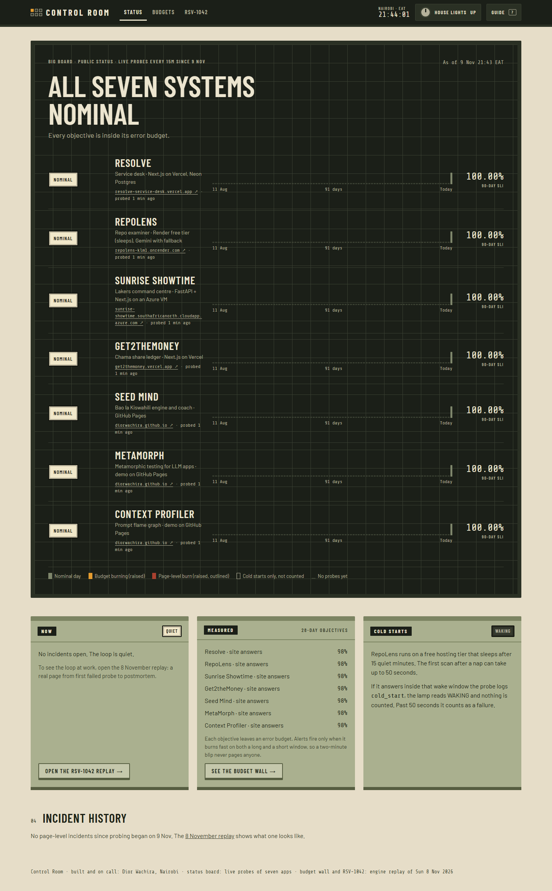
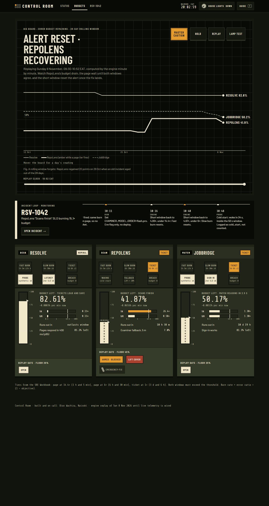
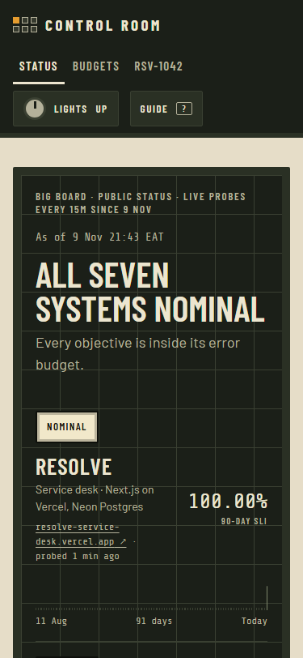

# Control Room

SLOs, multi-window burn-rate alerts and auto-filed incidents for my live apps:
**Resolve** (service desk), **RepoLens** (repo examiner) and **JobBridge** (job matching).

When an error budget burns too fast, Control Room opens a ticket in Resolve with the SLA clock
already running, pages me on Telegram, keeps the incident timeline and drafts a blameless
postmortem. A GitHub Action blocks risky deploys while a budget is under its floor.

> "My side projects have SLOs, burn-rate alerts and postmortems, and my own service desk pages me."

**Live:** https://diorwachira.github.io/control-room/ · the status board probes seven of my deployed
apps every 15 minutes (Resolve, RepoLens, Sunrise Showtime, Get2theMoney, Seed Mind, MetaMorph,
Context Profiler) and the real engine computes their error budgets. The budget wall and
RSV-1042 replay a real outage from 8 November. Take the guide, or press `?`.



| Guide bubble | Budget wall (replay) | Phone |
|---|---|---|
|  |  |  |

## Status
Working today (replay mode): the burn-rate engine, alert lifecycle, incident manager, deploy gate
API, postmortem draft, and the web UI (status board, budget console wall, incident detail, guide).
Live: synthetic probes → probe log → engine → Pages every 15 minutes, Telegram pages with an
Acknowledge button (acks read back onto the timeline), NO SIGNAL / SIGNAL LOST when data stops,
an LLM postmortem rewrite (Claude, cached, never published), a chaos drill in CI, SQLite state
for the Prometheus mode, and the telemetry stack as code (`infra/`, validated in CI).
Not yet: OpenTelemetry metrics from the apps (JobBridge deferred), Resolve's incident endpoint,
and the deploy gate wired into each app's workflow. See `roadmap.txt`.

## Run it

```bash
# engine (API on :8000, also serves web/dist if built)
cd engine
python -m venv .venv
.venv/Scripts/pip install -e ".[dev]"      # macOS/Linux: .venv/bin/pip
.venv/Scripts/python -m pytest -q
.venv/Scripts/python -m uvicorn controlroom.api:app --reload --port 8000
```

```bash
# web (dev server on :5173, proxies /api and /budget to :8000)
cd web
npm install
npm run dev
```

Production-style: `npm run build` in `web/`, then open http://localhost:8000.

```bash
# static demo + e2e (what GitHub Pages serves)
cd engine && .venv/Scripts/python -m controlroom.export ../web/.static/api
cd ../web && npx playwright test     # builds --mode static and serves it on :4174
```

```bash
# live probe mode locally
cd engine && .venv/Scripts/python -m controlroom.probe_runner ../probe-data/runs
CONTROLROOM_PROBE_DATA=../probe-data .venv/Scripts/python -m uvicorn controlroom.api:app --port 8000
.venv/Scripts/python -m controlroom.drill   # chaos drill: 7 checks against a throwaway local app
```

Optional repository secrets for the cron: `TELEGRAM_BOT_TOKEN` + `TELEGRAM_CHAT_ID` (pages and acks),
`ANTHROPIC_API_KEY` (postmortem rewrite), `HEALTHCHECK_URL` (dead-man switch).

```bash
# telemetry backbone (M1), on the VM
GRAFANA_ADMIN_PASSWORD=... docker compose -f infra/docker-compose.yml up -d
docker compose -f infra/docker-compose.yml --profile live up -d engine   # once apps send data
```

## How it works
1. Probes (today, `probes.yaml`) and OpenTelemetry (M1–M2, `slos.yaml`) count good and valid events per SLI.
2. Every minute the engine asks for error ratios over 5m, 30m, 1h, 6h, 3d and 28d.
3. Burn rate = error ratio ÷ (1 − objective). Tiers from the SRE Workbook: page at 14.4×
   (1h and 5m), page at 6× (6h and 30m), ticket at 1× (3d and 6h). Both windows must agree.
4. A firing tier opens one Resolve ticket per (service, SLO, class), pages, and writes the timeline.
5. When every page tier clears, the incident moves to Monitoring and resolves after 60 quiet minutes.
6. `GET /budget/{service}?labels=...` answers the deploy gate; `emergency-fix` overrides.

## Layout
```
slos.yaml                 SLOs and alert tiers as code
probes.yaml               what the live board watches (probe targets; tiers come from slos.yaml)
infra/                    collector, prometheus (35d), tempo, grafana; docker compose
Dockerfile                engine + web image
engine/controlroom/       config, sources, burnrate, alerts, incidents, engine, probes,
                          adapters (Resolve, Telegram), postmortem, status, scenario, api
engine/tests/             acceptance tests (blip, spike, one ticket, slow leak, gate, replay)
web/src/                  React UI: screens/, Guide.tsx + guideSteps.ts, styles.css (tokens)
web/e2e/                  Playwright tests (static build)
.github/actions/budget-gate/   composite action for the app repos
docs/resolve-api.md       endpoint Resolve needs to add
DECISIONS.md              why things are the way they are
roadmap.txt               milestones and handoff notes
```

## Design: "House Lights"
A 1960s mission operations room: one big board over a row of sage consoles; lamps are the only
colour. References: the restored Apollo Mission Operations Control Room (palette and console
row), Mission Control's "big boards" (shared projection screen), aircraft annunciator panels and
master caution (lamp grid, acknowledge, lamp test), the Google SRE Workbook (tiers become lamps),
GitHub-style status pages (component rows, 90-day bars), CSS scroll-driven animations (incident
log entries slide in). Type: Barlow Condensed, Barlow, Share Tech Mono.
